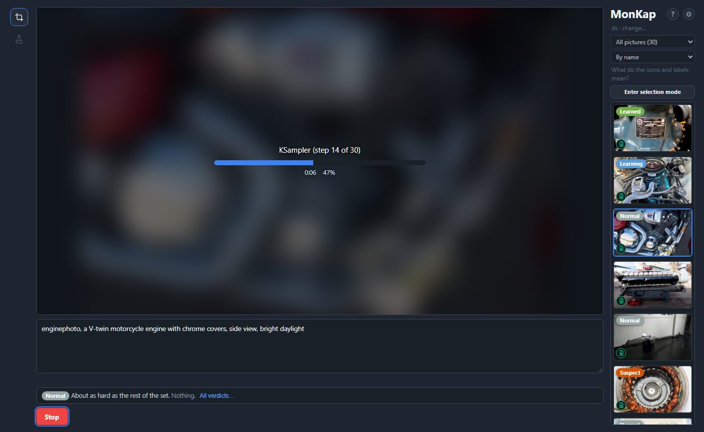
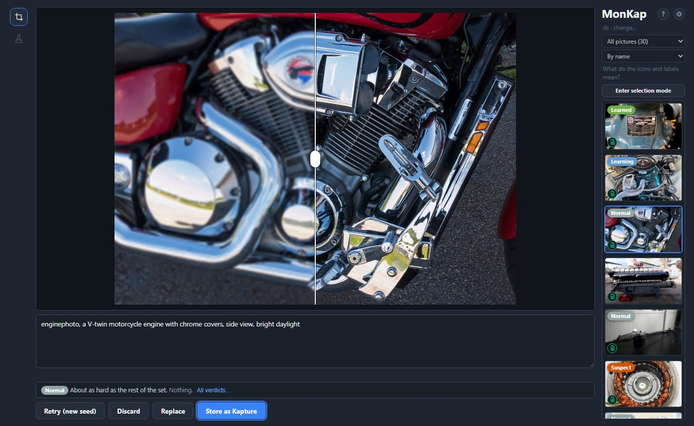
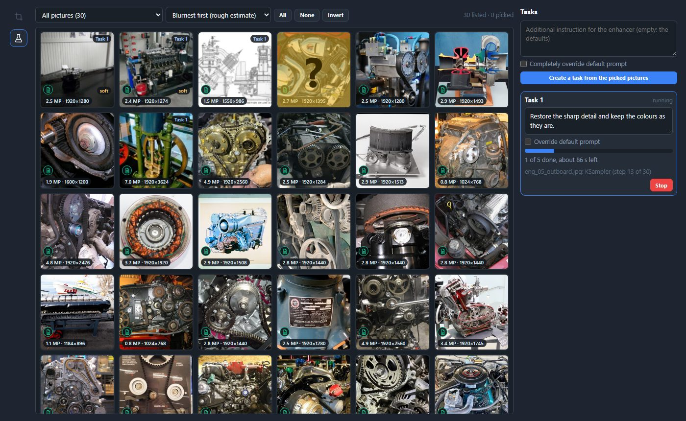
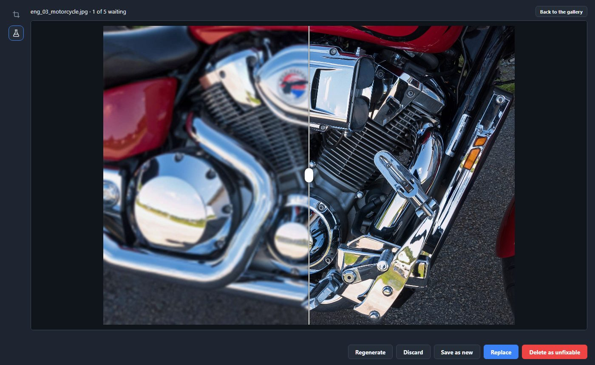
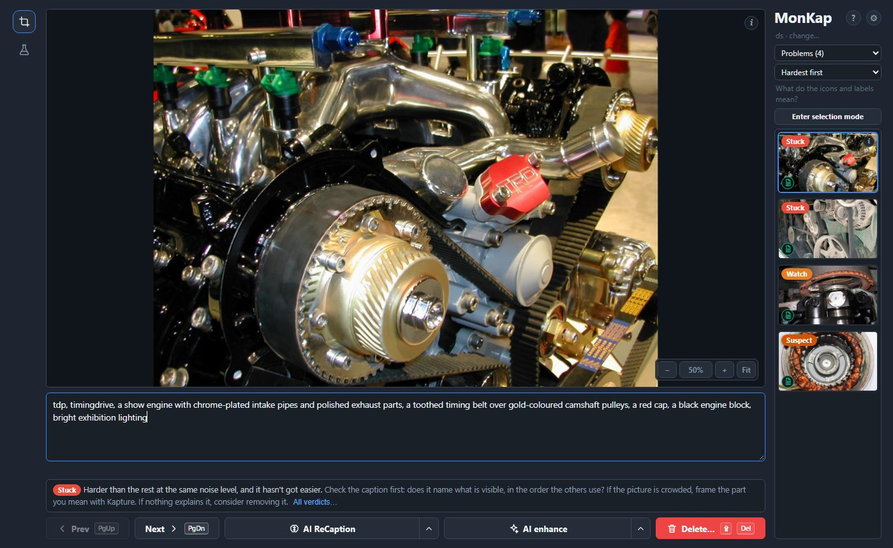

# MonKap

**Prepare image datasets for LoRA and fine-tune training: crop, caption, enhance and review every picture, mostly from the keyboard.**

[](https://github.com/DIGIDWARF-CC/MonKap/releases/latest)
[](LICENSE)


[**Download for Windows**](https://github.com/DIGIDWARF-CC/MonKap/releases/latest) · [Run from source](#run-from-source) · [Works with Fizgig](#fizgig)


Pictures are never resized behind your back, and nothing is erased without a way back unless you ask for it.

## What it does

- **Crop** a part of a picture into a new picture (Kapture), at the original's own pixels.
- **Caption** by hand with autosave, or with a vision model: LM Studio or any OpenAI-compatible server.
- **Enhance** a picture with your own ComfyUI, and compare before and after on a draggable divider.
- **Enhance a whole folder** in the Enhance lab: pick pictures, make a task, decide about each result.
- **Review training** when you train with [Fizgig](#fizgig): which pictures are stuck, and what to do about them.
- **Stay in control**: Undo for deletes, replaced originals and cleared captions; big folders open fast.

## Crop: Kapture

Drag a frame (ratio presets, size shown in pixels), press `C`, and the framed area is saved next to the original as a new PNG. The frame stays, so a four-panel page is four key presses. New pictures are named from a template (`{parent}_crop_{n:03d}`), and a number is never used twice.


## Caption

- The keyboard starts in the caption box. It saves by itself, and `PgUp` / `PgDn` walk through the folder.
- A **trigger word** per folder goes first in a caption with one button.
- **AI ReCaption** writes the caption again from scratch. The old text is kept, and *Restore previous caption* brings it back. The arrow next to the button takes a hint for the model.
- Small icons show who wrote each caption (nobody, you, or the model), and the *Show* list filters by them.
- **Selection mode** does the same for many pictures at once: ReCaption, trigger word, delete, with one Undo.

## Enhance with ComfyUI

The sparkle button hands the picture to a ComfyUI that is already running (MonKap never starts one). The progress is drawn on the picture itself. The result comes as a comparison with a draggable divider, then you choose: **Retry** (new seed), **Discard**, **Replace** (the original is kept, Undo brings it back) or **Store as Kapture**.

<p>


</p>

The result size is a setting: 1, 2 or 4 megapixels, or the picture's own size. Set the ComfyUI address and a workflow in the settings (see [Set up Enhance](#set-up-enhance)).

## Enhance lab

The second icon on the left switches to the lab: a gallery of the whole folder with each picture's size, a rough sharpness estimate (*blurriest first*) and its status.



1. **Pick** pictures (click, Shift+click, `Ctrl+A`).
2. **Make a task** with an optional extra instruction. *Completely override default prompt* makes that instruction the whole prompt; such a task wears an *overridden enhancer defaults* pill.
3. **Start**: ComfyUI works through the pictures one at a time, with progress and time left.
4. **Resolve** each result next to its original: **Regenerate**, **Discard**, **Save as new**, **Replace** or **Delete as unfixable**. `PgUp` / `PgDn` walk the pictures that wait.



Three failures in a row, or a ComfyUI that goes away, stop the task. Tasks and waiting results are kept on disk and survive a restart (a task that was running comes back *stopped*, never started by itself).

## Fizgig

Optional. Point the settings' Fizgig tab at a [Fizgig](https://github.com/shootthesound/Fizgig) install and MonKap reads, from its files only, never writing to them:

- the **trigger word** and **Caption Extension** of a folder,
- where Fizgig keeps its **latent cache** (erasing a picture for good clears its latents too),
- the **training review**: after a Fizgig run on the folder, each picture gets a label (Stuck, Suspect, Learning, Learned…), the verdict and what to do about it sit under the caption, and you can filter (*Problems*) and sort (*Hardest first*). A picture whose caption was changed after the run started counts as dealt with.



Checked against Fizgig 8.9.3. If Fizgig changes how it stores folders or settings this can stop working; MonKap then falls back to its own settings.

## Install (Windows 10 and 11)

1. Download `MonKap-<version>-setup.exe` from the [latest release](https://github.com/DIGIDWARF-CC/MonKap/releases/latest) and run it. It installs for your user (no administrator rights).
2. Start **MonKap** from the Start menu and open a folder of pictures.

The installer is not code-signed, so Windows SmartScreen may ask you to confirm (*More info*, *Run anyway*).

MonKap shows its page in the system's **WebView2** runtime. Windows 11 has it; Windows 10 usually gets it with Microsoft Edge. If the window doesn't open, install the Evergreen runtime from <https://developer.microsoft.com/microsoft-edge/webview2/>, or use the Start menu entry **MonKap (in the browser)**.

## Set up captions

Start LM Studio's server (or any OpenAI-compatible one: Ollama, llama.cpp, vLLM…). In the settings set its address (`http://localhost:1234` by default), press Refresh and choose a model that can see pictures. Each task's instruction is editable. The pictures are sent to that address, so use one you trust.

## Set up Enhance

In the settings' Enhance tab set your ComfyUI's address (`http://127.0.0.1:8188` by default) and press **Check**: it tells you, before anything is sent, whether the template is usable and whether that ComfyUI has the nodes and model files it asks for.

- **The template** is a ComfyUI workflow saved with *Save (API Format)*. MonKap finds its marked nodes by title: `MonKap Image` (the picture goes in), `MonKap Prompt` (the words), `MonKap Seed`, `MonKap Size` (optional: the size of the result) and `MonKap Result` (a preview node, so nothing lands in ComfyUI's output folder).
- **Download the reference template** gives a working one for Qwen Image 2.1, made only of ComfyUI's own nodes: pick your model files in its loaders. Or change anything between the marked nodes (another model, another editor) and use your file instead. A template made before 0.5.0 has no `MonKap Size` node and ignores the size setting; download the reference again to get it.
- **Free ComfyUI's memory** unloads its models, for when a trainer needs the video memory.

The picture is sent to ComfyUI's temporary folder under a random name, the result is fetched from there, and the run is removed from ComfyUI's history afterwards. ComfyUI itself may keep log lines and temporary files until it restarts.

## Run from source

Needs Python 3.10 or newer, on any system.

```bash
git clone https://github.com/DIGIDWARF-CC/MonKap.git
cd MonKap
pip install .
monkap
```

`monkap` starts the local server and opens the page in your browser. `monkap <folder>` opens a folder; `monkap --no-browser` only prints the address; `monkap --help` lists the rest. `pip install ".[window]"` adds `monkap-gui`, MonKap's own window, where pywebview works.

## Your files and your privacy

- The server listens on `127.0.0.1` only and wants a session key on every request. Nothing is sent anywhere except to the LM Studio and ComfyUI addresses you set.
- In a dataset folder MonKap keeps a hidden `.monkap` folder (crop ledger, caption backups, replaced originals), the pictures and captions you asked for, and `removed/` if you remove pictures.
- Its own files (settings, the folders you opened, the lab's tasks and waiting results) live in `user_data` next to `MonKap.exe`; run from source, in `%LOCALAPPDATA%\MonKap` on Windows, `~/.local/share/monkap` on Linux, `~/Library/Application Support/MonKap` on macOS, or in `MONKAP_HOME`. The settings' Data tab shows what is there and can remove it; `monkap --forget` does the same.
- The settings' *Current dataset maintenance* tab clears captions, empty caption files and `removed/` for the open folder; every button counts what it would do and asks first.

## Build the installer

```bash
python -m venv .venv
.venv\Scripts\pip install . pywebview pyinstaller
.venv\Scripts\python packaging\build.py
```

This makes `dist\MonKap\MonKap.exe` and, with [Inno Setup 6](https://jrsoftware.org/isinfo.php) installed, `dist\MonKap-<version>-setup.exe`.

## Tests

```bash
python -m unittest discover -s tests
node --test "tests/js/*.test.mjs"
```

No GPU, display or network is needed: the server, LM Studio client and ComfyUI client are tested against fake servers.

## Thanks

MonKap began as a dataset tool for LoRA training, and its file logic follows what trainers expect: a picture with no caption file is left out of training, a name never comes back, and a crop is cut from the original pixels.

Kudos to [**shootthesound**](https://github.com/shootthesound) for giving me an idea to make this app.
Be sure to check his work as well. [**Fizgig**](https://github.com/shootthesound/Fizgig) is just the one tool you need to do all of the work if you wish to train LoRAs for Flux 2 Klein 9B, Flux 3 Image Klein, Krea 2, MiniMax H3, Qwen Image 2.1, MOSS-Image, Z-Image Turbo, SDXL and Anima, and I really expect more to come.

## License

GPL-3.0, see [LICENSE](LICENSE).
