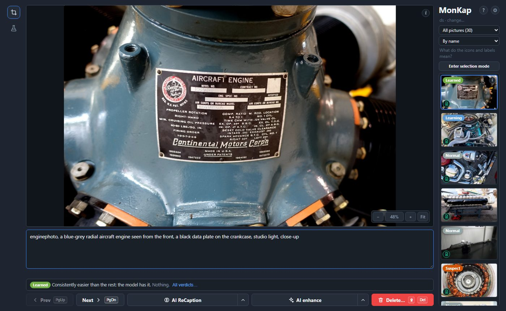
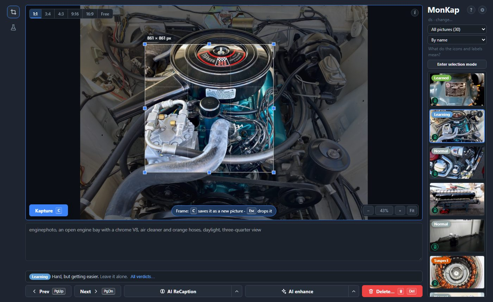
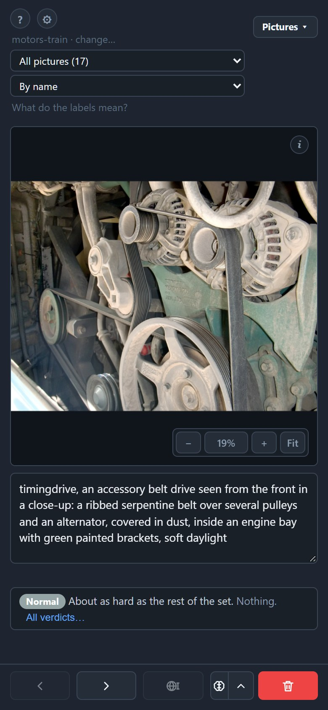
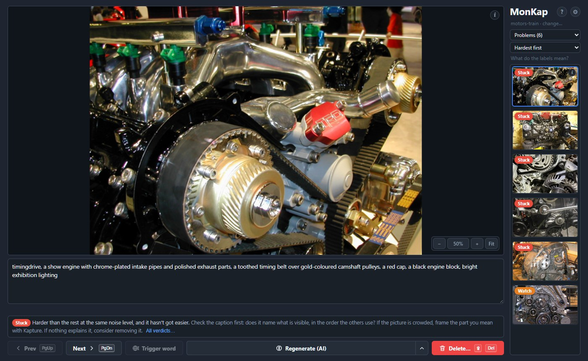
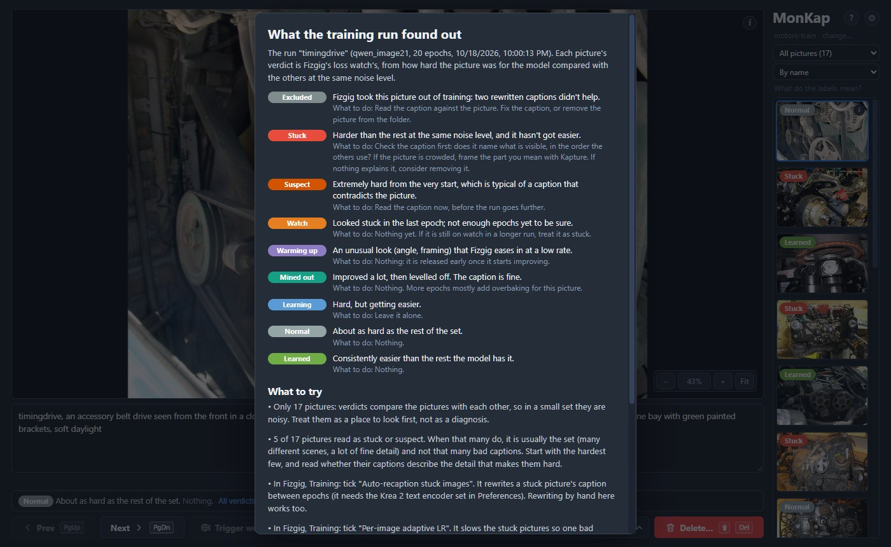
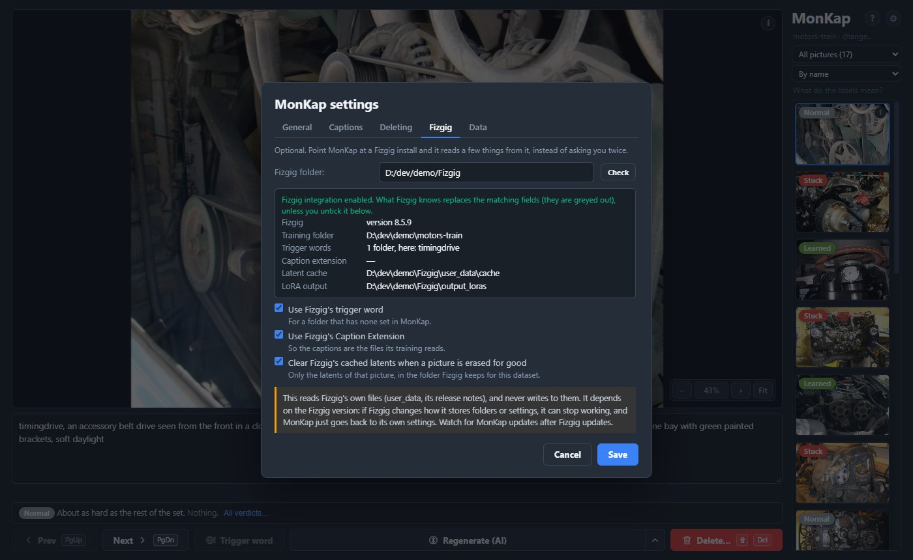

# MonKap

A workbench for preparing image datasets: frame and crop pictures, write and edit captions by hand or with a model, and review the whole set from the keyboard.

Pictures are never resized behind your back, and nothing is erased without a way back unless you ask for it.



## What it does

- **Kapture.** Drag a frame on a picture (ratio presets, the size shown in pixels), press `C`, and the framed area is saved next to the original as a new PNG, at the original's own pixels. The frame stays, so a four-panel page is four key presses. New pictures get names from a template (`{parent}_crop_{n:03d}`), and a number is never used twice, even after a crop is deleted.
- **Captions.** The keyboard starts in the caption box; it saves by itself, and `PgUp` / `PgDn` walk through the folder. Clearing a caption on purpose removes the file (the old text is backed up first). A folder can have a trigger word, which MonKap can put first in a caption with one button.
- **AI ReCaption.** The brain button writes the caption again, from scratch, with a model served by LM Studio, or by any server with an OpenAI-style API (Ollama, llama.cpp, vLLM…): the old text is replaced (it is kept, and *Restore previous caption* brings it back). Pick the model and the task in the settings; each task's instruction is editable. The arrow next to the button takes a hint for the model and has *Unload the model from LM Studio* (the model you picked only; unloading one that isn't loaded is no error).
- **AI enhance.** The sparkle button hands the picture to a ComfyUI that is already running (MonKap never starts one) and shows the progress, with ComfyUI's own preview frames. The result is looked at next to the original, and then: **Retry** (another seed), **Discard**, **Replace** (the original is kept in `.monkap/replaced/`, and Undo brings it back) or **Store as Kapture** (a new picture next to the original, named and captioned like a crop). The arrow next to it takes your own words for the picture and has *Unload the models from ComfyUI*. See [Enhance](#enhance-with-comfyui) below.
- **Who wrote a caption, and what changed.** Small round icons on every picture, in the filmstrip and in the gallery: a page with text (yellow: no caption, green: written or edited by hand, blue: written by the model and not touched since) and, when the picture was enhanced by AI, sparkles. The *Show* list filters by them (No caption, Written by hand, Written by AI, Enhanced by AI), sorts by when the caption changed, and, when a Fizgig run has trained on the folder, by whether a caption changed since that run started. MonKap keeps these notes in the folder's `.monkap/pictures.json`; a caption it has no note of counts as written by hand, and so does any text you have changed.
- **Selection mode.** *Enter selection mode* above the filmstrip: a click on a picture picks it (Shift+click a range; icons for all, none and invert; they act on what the list shows, so a filter never hides a picked picture). The picture area becomes a gallery of the picked ones: click a tile to edit its caption below, double-click (or the arrow on the tile) to open it as a picture, and *Back to selection gallery* returns. The gallery is for the mouse; the keyboard stays with the caption box (`PgUp` / `PgDn` walk the picked pictures). **AI ReCaption** (with a hint for all of them) writes the captions one after another: each tile shows a spinner, then its icon turns blue (a red mark if it failed), with *Stop processing* and *Undo captions* above; **Trigger word** puts the folder's word first in every picked caption; **Delete selected** removes them together and always asks, whatever the settings say about asking (one Undo for the whole pack in the soft mode). The pick is remembered for each folder while the page is open: leave the mode and come back, or open another folder and return, and it is there (names that left the folder are dropped; *Select none* clears it).
- **Big folders and big pictures.** A virtual filmstrip (a 4000-picture folder opens in a fraction of a second), a whole-picture preview, and full-resolution tiles when you zoom in. Pinch-zoom works on touch.
- **Delete.** Either move to the folder's `removed/` with Undo, or erase for good. Your choice in the settings.
- **Current dataset maintenance.** A tab of the settings with housekeeping of the folder that is open: *Clear all captions* (each text is kept in `.monkap/backups`, and Undo brings them back), *Delete empty caption files*, *Empty the removed/ folder* and *Forget MonKap's notes*. Every button counts what it would do and always asks first; the asking cannot be switched off.



The layout follows the window: in a narrow window (or on a touch screen) the picture goes first and the buttons become one row at the bottom.



## Install (Windows 10 and 11)

Run `MonKap-<version>-setup.exe`. It installs for your user (no administrator rights) and adds a Start menu entry.

MonKap shows its page in the system's **WebView2** runtime. Windows 11 has it. On Windows 10 it usually comes with Microsoft Edge, but an old Windows 10 may only have the older web view: if the window doesn't open, install the Evergreen runtime from <https://developer.microsoft.com/microsoft-edge/webview2/>. Or use the Start menu entry **MonKap (in the browser)**, which opens the same page in your default browser instead of a window.

For captions with a model, start LM Studio's server (or any compatible one), and in MonKap's settings set the address (`http://localhost:1234` is the default), press Refresh, and choose a model that can see pictures. The pictures are sent to that address, so use one you trust.

## Enhance with ComfyUI

Optional. In the settings, the Enhance tab takes the address of your ComfyUI (`http://127.0.0.1:8188` by default) and a template. **Check** tells you, before anything is sent, whether the template is usable and whether that ComfyUI has the nodes and model files it asks for. **Free ComfyUI's memory** unloads its models, for when a trainer needs the video memory.

The template is a ComfyUI workflow saved with *Save (API Format)*. MonKap knows nothing about what is between four marked nodes, found by their titles: `MonKap Image` (the picture goes in), `MonKap Prompt` (the words), `MonKap Seed` and `MonKap Result` (a preview node, so nothing lands in ComfyUI's output folder). **Download the reference template** in the settings gives a working one made only of ComfyUI's own nodes, for Qwen Image 2.1: pick your model files in its three loaders, or change whatever you like between the marked nodes (another model, another editor) and use your file instead. Keep the four nodes and keep them linked; MonKap checks that.

The picture is sent to ComfyUI's temporary folder under a random name, the result is fetched from there, and the run is removed from ComfyUI's history afterwards. ComfyUI itself may keep log lines and its temporary files until it restarts.

## Run from source (any system)

Needs Python 3.10 or newer.

```bash
git clone https://github.com/DIGIDWARF-CC/MonKap.git
cd MonKap
pip install .
monkap
```

`monkap` starts the local server and opens the page in your browser. `monkap <folder>` opens a folder; `monkap --no-browser` only prints the address (for a Linux box without a browser, or to open it from another program); `monkap --help` lists the rest. `pip install ".[window]"` adds `monkap-gui`, MonKap's own window, on systems where pywebview works.

## Fizgig

Optional. In the settings, the Fizgig tab takes the folder of a [Fizgig](https://github.com/shootthesound/Fizgig) install, and MonKap reads a few things from it instead of asking you twice: the trigger word of a folder, the Caption Extension, and where Fizgig keeps its latent cache (so erasing a picture for good also clears its latents). MonKap only reads Fizgig's files and never writes to them.

**Training review.** With the Fizgig folder set, and once a Fizgig run has trained on the folder you have open, MonKap reads that run's per-image loss watch and shows it where you work: a coloured label on each picture (Stuck, Suspect, Learning, Learned…), the verdict and what to do about it under the caption, a list you can filter ("Problems") and sort ("Hardest first"), and a page that explains every label and, from the run's own settings, which of Fizgig's options could help (auto-recaption, per-image LR, where learning finished). It shows no charts: Fizgig's Runs page has them. A picture whose caption was changed after the run started has been dealt with, whether you changed it or Fizgig's auto-recaption did: its label goes, and "Problems" counts only what is still open. When Fizgig is set up but has no run on the folder, a yellow (!) *No training data* says why when clicked.





The page checks for changes every few seconds while it is open, so verdicts appear as a run writes them, and a new trigger word or caption extension set in Fizgig shows up without reloading. A caption you are typing is never overwritten.

If you moved your Fizgig folder after a run, MonKap still finds the run's results: Fizgig records absolute paths, so when the recorded folder is gone MonKap looks for it in this Fizgig's output folder, and a note under the filters says so. When it finds nothing, the same place says why.



This depends on the Fizgig version. It was checked against Fizgig 8.5.9, and if Fizgig changes how it stores folders or settings it can stop working (MonKap then falls back to its own settings). Watch for MonKap updates after Fizgig updates.

## What it keeps on your computer

MonKap's own files are the settings and the list of folders you opened. The installed program keeps them in the `user_data` folder next to `MonKap.exe`, so removing the program's folder removes them too (the uninstaller asks first). Run from source, they go to `%LOCALAPPDATA%\MonKap` on Windows, `~/.local/share/monkap` on Linux, `~/Library/Application Support/MonKap` on macOS, or to the folder in `MONKAP_HOME`. The settings dialog shows what is there and can remove it; `monkap --forget` does the same. In a dataset folder MonKap keeps a hidden `.monkap` folder (the crop ledger and caption backups), the pictures and captions you asked for, and `removed/` if you remove pictures. Previews and tiles are made in memory.

The server listens on 127.0.0.1 only and wants a session key on every request. The browser keeps its usual cache for the page, as any page does.

## Build the installer

```bash
python -m venv .venv
.venv\Scripts\pip install . pywebview pyinstaller
.venv\Scripts\python packaging\build.py
```

This makes `dist\MonKap\MonKap.exe` (a folder, so nothing unpacks itself into the temp folder on start) and, with [Inno Setup 6](https://jrsoftware.org/isinfo.php) installed, `dist\MonKap-<version>-setup.exe`.

## Tests

```bash
python -m unittest discover -s tests
node --test "tests/js/*.test.mjs"
```

No GPU, no display and no network are needed. The server and the LM Studio client are tested against fake servers.

## Where it came from

MonKap started as a dataset tool for a LoRA trainer, and its file logic follows what trainers expect: a picture with no caption file is left out of training, a name never comes back, and a crop is cut from the original pixels.

## License

GPL-3.0, see `LICENSE`.
